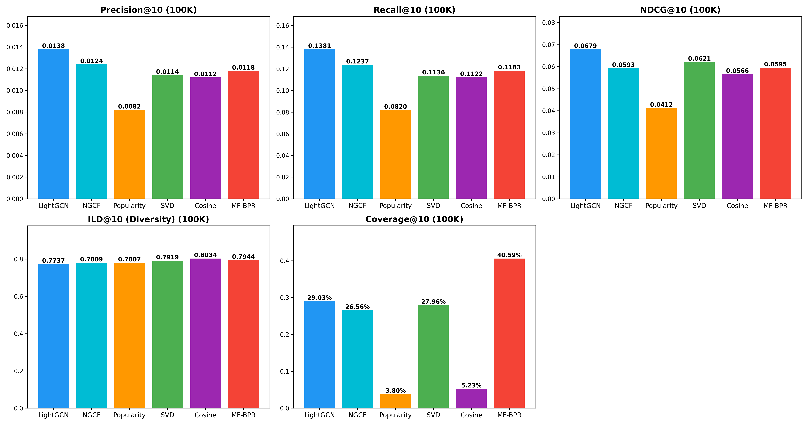
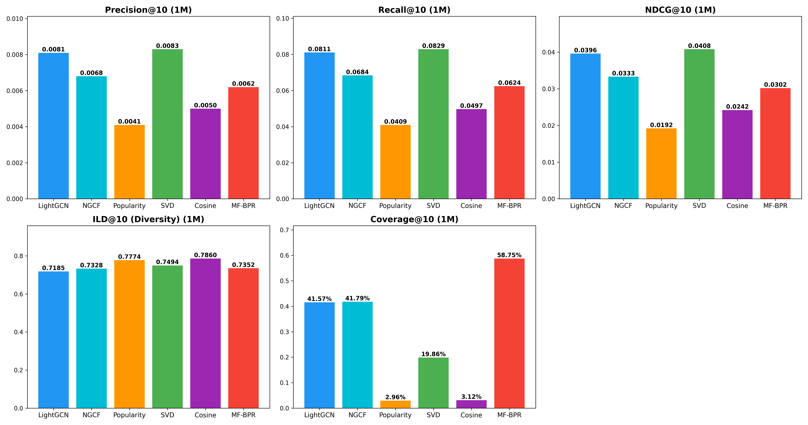
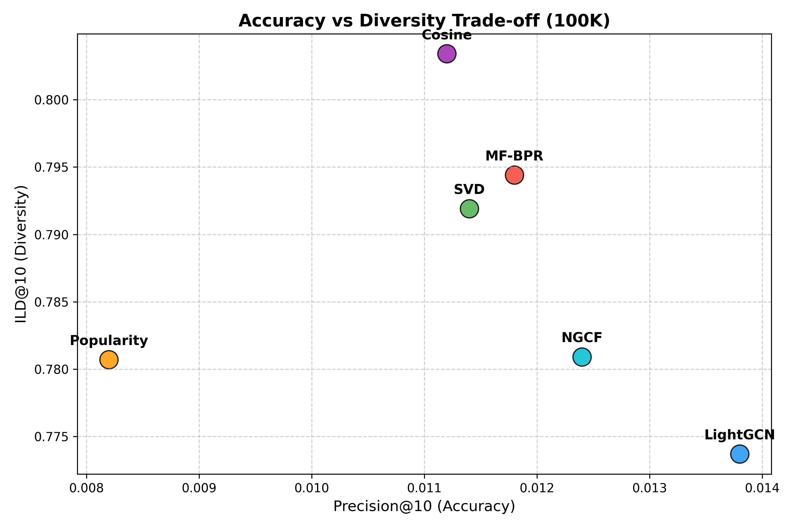
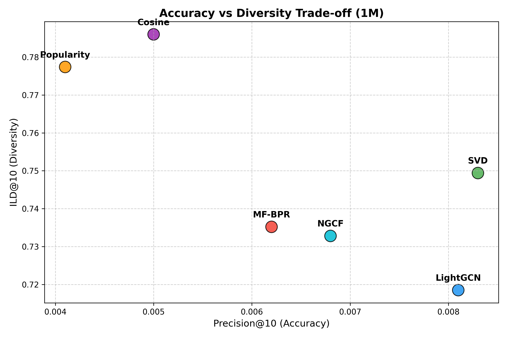
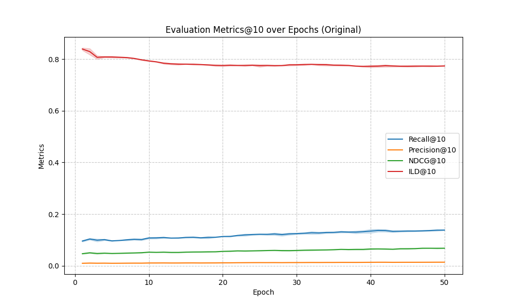
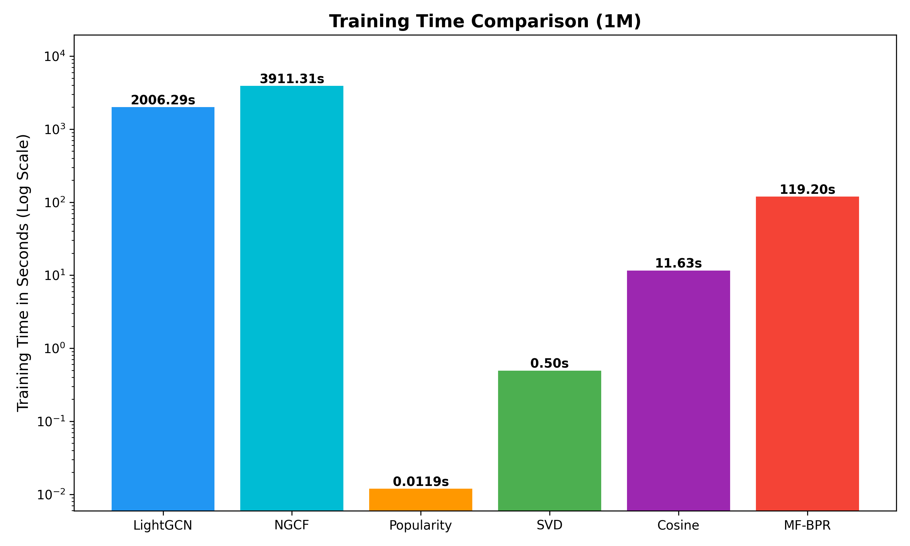

# A Comparative Study of LightGCN and Traditional Collaborative Filtering Methods for Movie Recommendation

**Course:** COMP4330SEF — Project (P07 Group 6)  
**Focus:** Accuracy, Intra-List Diversity, Catalog Coverage, and Computational Efficiency across MovieLens Scales  
**Experimental Hardware:** Google Colab Pro / Cloud Environment (**NVIDIA Tesla T4 GPU + High-RAM Runtime**)

## 🔗 Reproducible Google Colab Notebooks

All experiments were executed on Google Colab using an **NVIDIA T4 GPU with High-RAM** enabled. You can inspect our complete training logs, statistical tests, and execution outputs directly via the links below:

* **MovieLens 1M Benchmark:** [](https://colab.research.google.com/drive/1S5cNzFLCl_03RhHe_FiY_M2j6X7UzPFg?usp=sharing)
* **MovieLens 100K Benchmark:** [](https://colab.research.google.com/drive/1Q7yIX6Z_EYMZXF5nmoG-S7LUMxDJ11w4?usp=sharing)
* **MovieLens Latest-Small (Prototyping):** [](https://colab.research.google.com/drive/1jEbe2mZUjsyHewwzy6zJ615Cmhc0gYqc?usp=sharing)

## 👥 Project Team (P07 Group 6)

| Member Name | Student ID |
| :--- | :--- |
| **SUM Ka On** *(Group Leader)* | 13896581 |
| **SHAM Ying Ho** | 13975793 |
| **CHAN Chi Ho** | 12980916 |
| **LEE KA MEI** | 14077641 |
| **Ng Tsz Chung** | 14029225 |
| **Sham Hoi Laam** | 13902788 |

## 📖 Project Overview & Key Findings

While Graph Neural Networks (GNNs) such as **LightGCN** are widely regarded as state-of-the-art for collaborative filtering, recent studies (e.g., Bojorque et al., 2026) have questioned whether complex graph architectures truly outperform well-tuned classical matrix factorization on standard movie benchmarks, and whether accuracy gains come at the expense of recommendation diversity.

In this project, we conduct a rigorous, multi-seed empirical study across three MovieLens scales (**Latest-Small**, **100K**, and **1M**) using a chronological **Leave-One-Out (LOO)** full-catalog evaluation protocol:

1. **Refuting Prior Claims on Full-Catalog Ranking:** Under strict full-catalog ranking (masking seen items with $-\infty$ rather than sampling small negative subsets), **LightGCN** achieves the highest accuracy on sparse datasets (**MovieLens 100K NDCG@10 = 0.0679**), whereas classical **Truncated SVD** slightly edges out LightGCN on denser million-scale data (**MovieLens 1M NDCG@10 = 0.0408 vs. 0.0396**), with both models significantly outperforming **MF-BPR** ($p < 0.001$).
2. **LightGCN vs. NGCF Efficiency & Accuracy:** By removing non-linear activations and feature transformation matrices, LightGCN outperforms NGCF in accuracy across all datasets while cutting training time on MovieLens 1M nearly in half (**2006s vs. 3911s**) and reducing per-user inference latency by over 50%.
3. **Over-Smoothing & Diversity Trade-off:** Layer ablation (1 to 4 layers) demonstrates that accuracy peaks at **3 layers**, while **Intra-List Diversity (ILD@10)** monotonically decreases as layers deepen, providing direct empirical proof of GNN over-smoothing.
4. **In-Batch Diversity Regularization:** Introducing an in-batch positive embedding cosine similarity penalty ($\lambda_{\text{div}} = 0.1$) significantly expands **Catalog Coverage** (from **29.03% to 34.44%** on 100K, and **41.57% to 44.73%** on 1M), effectively mitigating popularity bias.

## 📂 Repository Structure & Dataset Identification Guide

Because our training scripts (`comparison_lightgcn.py`, `train_ngcf.py`, and `baselines.py`) are standardized to read `./Datasets/movies.csv` and `./Datasets/ratings.csv` relative to their working directory, **every dataset folder is named `Datasets/`**. You can identify which MovieLens scale a `Datasets/` folder contains by checking its **parent directory**:

```text
lightgcn-vs-cf-movie-benchmark/
├── Datasets/                                    # 📌 [DEFAULT: MovieLens 100K] Standardized CSVs for the Flask Web Demo
│   ├── movies.csv                               # 1,682 movies (converted from u.item)
│   └── ratings.csv                              # 100,000 ratings (converted from u.data)
├── run_colab/                                   # ☁️ Self-contained folders ready for Google Colab or Local CLI execution
│   ├── using_ml-latest-small/
│   │   ├── Datasets/                            # 📌 [MovieLens Latest-Small] ~100K ratings across 610 users & 9,742 movies
│   │   ├── comparison_lightgcn.py
│   │   ├── train_ngcf.py
│   │   └── baselines.py
│   ├── using_ml-100k/
│   │   ├── Datasets/                            # 📌 [MovieLens 100K] 100,000 ratings across 943 users & 1,682 movies
│   │   ├── comparison_lightgcn.py
│   │   ├── train_ngcf.py
│   │   └── baselines.py
│   └── using_ml-1m/
│       ├── Datasets/                            # 📌 [MovieLens 1M] ~1,000,209 ratings (~21.5 MB ratings.csv)
│       ├── comparison_lightgcn.py
│       ├── train_ngcf.py
│       └── baselines.py
├── Results/                                     # 📊 Pre-generated plots, checkpoints (.pth) & Colab notebooks
│   ├── results_ml-1m/                           # Outputs & lightgcn_model.pth for MovieLens 1M
│   ├── results_ml-100k/                         # Outputs & lightgcn_model.pth for MovieLens 100K
│   └── results_ml-latest-small/                 # Outputs for MovieLens Latest-Small
├── static/                                      # Benchmark visualizations served by the Flask Web App (100K)
├── templates/
│   └── index.html                               # CINEGRAPH Bilingual (EN/繁中) Web UI
├── app.py                                       # Flask real-time recommendation server (LightGCN vs. SVD)
├── comparison_lightgcn.py                       # Root LightGCN module imported by app.py (configured for 100K)
├── lightgcn_model.pth                           # Pre-trained MovieLens 100K checkpoint loaded by app.py (~594 KB)
├── prepare_dataset.py                           # Utility script to convert raw MovieLens 100K (u.data) & 1M (.dat) into CSV
├── requirements.txt                             # Python dependencies
└── README.md                                    # Project documentation
```

### 🔍 Quick Reference: Which `Datasets/` Folder is Which?

| Directory Path | Dataset Scale | `ratings.csv` Size | Primary Purpose |
| :--- | :--- | :---: | :--- |
| `lightgcn-vs-cf-movie-benchmark/Datasets/` | **MovieLens 100K** | ~2.4 MB | Default dataset loaded by `app.py` (CINEGRAPH Flask Web Demo) |
| `run_colab/using_ml-latest-small/Datasets/` | **MovieLens Latest-Small** | ~2.4 MB | Rapid prototyping and initial pipeline validation |
| `run_colab/using_ml-100k/Datasets/` | **MovieLens 100K** | ~2.4 MB | Primary benchmark experiment (942 active users, 1,427 items) |
| `run_colab/using_ml-1m/Datasets/` | **MovieLens 1M** | ~21.5 MB | Large-scale benchmark validation (6,035 active users, 3,525 items) |

## 📊 Experimental Results Summary

All stochastic models were evaluated across **3 random seeds (`[16, 42, 2026]`)** following a chronological Train / Validation / Test Leave-One-Out split on positive implicit feedback ($\text{rating} \ge 4$).

### 1. MovieLens 100K Benchmark (`n_users=942`, `n_items=1,427`)

| Model | Precision@10 | Recall@10 | NDCG@10 | NDCG@20 | ILD@10 (Diversity) | Coverage@10 | Train Time (s) | Infer / User (ms) |
| :--- | :---: | :---: | :---: | :---: | :---: | :---: | :---: | :---: |
| **LightGCN (Original)** | 0.0138 ± 0.0001 | 0.1381 ± 0.0009 | **0.0679 ± 0.0005** | **0.0888 ± 0.0003** | 0.7737 ± 0.0007 | 29.03% | 22.34s | **0.0017** |
| **LightGCN (Improved, $\lambda=0.1$)** | **0.0140 ± 0.0002** | **0.1402 ± 0.0023** | **0.0689 ± 0.0015** | 0.0884 ± 0.0018 | 0.7678 ± 0.0008 | 34.44% | 23.55s | **0.0016** |
| **SVD (Truncated)** | 0.0114 ± 0.0003 | 0.1136 | 0.0621 | 0.0800 | 0.7919 | 27.96% | 0.10s | 0.0806 |
| **MF-BPR** | 0.0118 ± 0.0007 | 0.1183 | 0.0595 | 0.0771 | 0.7944 | **40.59%** | 11.84s | 0.0292 |
| **NGCF** | 0.0124 ± 0.0003 | 0.1237 ± 0.0033 | 0.0593 ± 0.0016 | 0.0765 ± 0.0022 | 0.7809 ± 0.0027 | 26.56% | 34.51s | 0.0158 |
| **Cosine Similarity** | 0.0112 | 0.1122 | 0.0566 | 0.0699 | **0.8034** | 5.23% | 0.20s | 0.0291 |
| **Popularity** | 0.0082 | 0.0820 | 0.0412 | 0.0550 | 0.7807 | 3.80% | 0.0070s | 0.0069 |



### 2. MovieLens 1M Benchmark (`n_users=6,035`, `n_items=3,525`)

| Model | Precision@10 | Recall@10 | NDCG@10 | NDCG@20 | ILD@10 (Diversity) | Coverage@10 | Train Time (s) | Infer / User (ms) |
| :--- | :---: | :---: | :---: | :---: | :---: | :---: | :---: | :---: |
| **SVD (Truncated)** | **0.0083 ± 0.0001** | **0.0829** | **0.0408** | **0.0554** | 0.7494 | 19.86% | 0.50s | 0.0619 |
| **LightGCN (Original)** | 0.0081 ± 0.0002 | 0.0811 ± 0.0021 | 0.0396 ± 0.0007 | 0.0539 ± 0.0011 | 0.7185 ± 0.0015 | 41.57% | 2006.29s | **0.0014** |
| **LightGCN (Improved, $\lambda=0.1$)** | 0.0075 ± 0.0001 | 0.0746 ± 0.0014 | 0.0364 ± 0.0009 | 0.0496 ± 0.0010 | 0.7082 ± 0.0018 | 44.73% | 2013.16s | **0.0014** |
| **NGCF** | 0.0068 ± 0.0004 | 0.0684 ± 0.0044 | 0.0333 ± 0.0023 | 0.0456 ± 0.0014 | 0.7328 ± 0.0027 | 41.79% | 3911.31s | 0.0035 |
| **MF-BPR** | 0.0062 ± 0.0001 | 0.0624 | 0.0302 | 0.0414 | 0.7352 | **58.75%** | 119.20s | 0.0474 |
| **Cosine Similarity** | 0.0050 | 0.0497 | 0.0242 | 0.0323 | **0.7860** | 3.12% | 11.63s | 0.0556 |
| **Popularity** | 0.0041 | 0.0409 | 0.0192 | 0.0271 | 0.7774 | 2.96% | 0.0119s | 0.0120 |



### 3. LightGCN Layer Depth Ablation (Seed = 16)

| Number of Layers | 100K NDCG@10 | 100K ILD@10 | 100K Train Time | 1M NDCG@10 | 1M ILD@10 | 1M Train Time |
| :---: | :---: | :---: | :---: | :---: | :---: | :---: |
| **1 Layer** | 0.0658 | **0.7824** | 14.86s | 0.0356 | **0.7286** | 718.33s |
| **2 Layers** | 0.0683 | 0.7754 | 18.10s | 0.0388 | 0.7213 | 1366.04s |
| **3 Layers** | **0.0684** | 0.7735 | 21.73s | **0.0404** | 0.7165 | 1990.45s |
| **4 Layers** | 0.0617 | 0.7747 | 26.30s | 0.0398 | 0.7128 | 2642.41s |

### 4. Visualized Trade-offs & Training Dynamics

| Accuracy vs. Diversity (100K) | Accuracy vs. Diversity (1M) |
| :---: | :---: |
|  |  |
| **LightGCN Metrics Curve (100K)** | **Training Time Log-Comparison (1M)** |
|  |  |

## 🚀 How to Run Training & Evaluation (Colab Cloud vs. Local PC)

We designed the `run_colab/` directory so that each dataset benchmark (`using_ml-latest-small`, `using_ml-100k`, and `using_ml-1m`) is completely self-contained. You can run the training scripts either **on Google Colab (recommended for GPU acceleration, especially on 1M)** or **on your local machine**.

### Option A: Running on Google Colab (Recommended — T4 GPU + High-RAM)

If you do not wish to train locally, you can upload the `run_colab/` folder (or clone this repository) directly into Google Colab:

1. **Configure Colab Runtime:**
   * Open a new Google Colab notebook.
   * Go to **Runtime** $\rightarrow$ **Change runtime type**.
   * Select **T4 GPU** under Hardware accelerator, toggle on **High-RAM**, and click **Save**.
2. **Upload Files or Clone Repository:**
   * **Method 1 (Direct Clone in Colab):**
     ```bash
     !git clone [https://github.com/tomSum3345678/lightgcn-vs-cf-movie-benchmark.git](https://github.com/tomSum3345678/lightgcn-vs-cf-movie-benchmark.git)
     %cd lightgcn-vs-cf-movie-benchmark/run_colab/using_ml-100k
     ```
     *(Change `using_ml-100k` to `using_ml-1m` or `using_ml-latest-small` depending on which benchmark you want to run.)*
   * **Method 2 (Manual Upload to Colab):**
     In the Colab left sidebar (Files tab), create a folder (e.g., `/content/run_colab/using_ml-100k/`), upload `comparison_lightgcn.py`, `train_ngcf.py`, and `baselines.py` into it, create a subfolder named `Datasets/`, and upload the corresponding `movies.csv` and `ratings.csv` into `Datasets/`. Then set your working directory:
     ```python
     %cd /content/run_colab/using_ml-100k
     ```
3. **Install PyTorch Geometric in Colab:**
   ```bash
   !pip install torch-geometric
   ```
4. **Execute the Benchmark Scripts in Order:**
   ```bash
   # 1. Train Original & Improved LightGCN + Layer Analysis + Paired t-tests (saves lightgcn_model.pth & plots)
   !python comparison_lightgcn.py

   # 2. Train & evaluate NGCF across 3 seeds
   !python train_ngcf.py

   # 3. Run Popularity, SVD, Cosine, and MF-BPR baselines & generate comparison charts
   !python baselines.py
   ```

### Option B: Running Locally on Your Computer

1. **Install Dependencies:**
   ```bash
   pip install -r requirements.txt
   ```
2. **Navigate to the Target Dataset Folder under `run_colab/`:**
   ```bash
   # Example: Run the MovieLens 100K benchmark locally
   cd run_colab/using_ml-100k

   python comparison_lightgcn.py
   python train_ngcf.py
   python baselines.py
   ```
   *(Note: If you download raw `u.data`/`u.item` or `.dat` files from GroupLens in the future, you can use `python prepare_dataset.py` in the root folder to convert them into `movies.csv` and `ratings.csv`.)*

## 🌐 Running the CINEGRAPH Bilingual Web Demo (Local Flask Server)

We built a modern, theater-styled bilingual (**English / 繁體中文**) Flask web application (`CINEGRAPH`) that enables real-time side-by-side comparison between **LightGCN** and **Truncated SVD**, displaying live **Intra-List Diversity (ILD@K)**, **per-user inference latency**, **multi-genre filtering**, and direct **IMDb search integration**.

By default, the root directory is pre-configured with the **MovieLens 100K** dataset (`./Datasets/movies.csv` and `./Datasets/ratings.csv`) and the pre-trained 100K checkpoint (`./lightgcn_model.pth`) for instant startup:

1. From the project root (`lightgcn-vs-cf-movie-benchmark/`), start the Flask server:
   ```bash
   python app.py
   ```
2. Open your browser and navigate to:
   ```text
   [http://127.0.0.1:5000](http://127.0.0.1:5000)
   ```

## 🙏 Acknowledgements & Inspiration

* **Baseline Code Inspiration:** This project was initially inspired by [Sathwikreddy121/Movie-Recommendation-Website-using-LightGCN-approach](https://github.com/Sathwikreddy121/Movie-Recommendation-Website-using-LightGCN-approach) for the foundational LightGCN and Flask demo concept.
* **Benchmark Reference:** Our cross-scale evaluation also directly examines and tests the MovieLens 1M claims from [Rodolfoxbc/beyond-model-complexity-recsys](https://github.com/Rodolfoxbc/beyond-model-complexity-recsys) (Bojorque et al., 2026).

Building upon these foundations, our team independently designed and implemented:
1. A strict chronological **Leave-One-Out (LOO) full-catalog evaluation pipeline** across **MovieLens Latest-Small, 100K, and 1M** with 3 random seeds and **paired Student's t-tests**.
2. Multi-dimensional benchmarking across **6 models** (LightGCN, NGCF, Truncated SVD, MF-BPR, Cosine Similarity, and Popularity) covering **Precision, Recall, NDCG, ILD@10, Catalog Coverage, and runtime latency**.
3. An **in-batch cosine diversity regularizer ($\lambda_{\text{div}} = 0.1$)** and a **1-to-4 layer GNN over-smoothing ablation study**.
4. A redesigned **bilingual (EN / 繁中) Flask Web App** featuring real-time LightGCN vs. SVD side-by-side comparison, live ILD and latency metrics, multi-genre filtering, and IMDb search links.

## 🗄️ Dataset Acknowledgment

This project utilizes the **MovieLens** datasets (`ml-latest-small`, `ml-100k`, and `ml-1m`) provided by [GroupLens Research](https://grouplens.org/datasets/movielens/) at the University of Minnesota. Per the official dataset usage guidelines, we acknowledge and cite:

> F. Maxwell Harper and Joseph A. Konstan. 2015. The MovieLens Datasets: History and Context. *ACM Transactions on Interactive Intelligent Systems (TiiS)* 5, 4, Article 19 (December 2015), 19 pages. DOI=[http://dx.doi.org/10.1145/2827872](http://dx.doi.org/10.1145/2827872)

```bibtex
@article{harper2015movielens,
  author    = {Harper, F. Maxwell and Konstan, Joseph A.},
  title     = {The MovieLens Datasets: History and Context},
  journal   = {ACM Transactions on Interactive Intelligent Systems (TiiS)},
  volume    = {5},
  number    = {4},
  articleno = {19},
  numpages  = {19},
  month     = dec,
  year      = {2015},
  doi       = {10.1145/2827872},
  url       = {[http://dx.doi.org/10.1145/2827872](http://dx.doi.org/10.1145/2827872)},
  publisher = {ACM}
}
```

## 📚 References

1. Koren, Y., Bell, R., & Volinsky, C. (2009). Matrix factorization techniques for recommender systems. *Computer*, 42(8), 30–37. https://doi.org/10.1109/MC.2009.263
2. He, X., Deng, K., Wang, X., Li, Y., Zhang, Y., & Wang, M. (2020). LightGCN: Simplifying and powering graph convolution network for recommendation. *Proceedings of the 43rd International ACM SIGIR Conference on Research and Development in Information Retrieval*, 639–648. https://doi.org/10.1145/3397271.3401063
3. Wang, X., He, X., Wang, M., Feng, F., & Chua, T.-S. (2019). Neural graph collaborative filtering. *Proceedings of the 42nd International ACM SIGIR Conference on Research and Development in Information Retrieval*, 165–174. https://doi.org/10.1145/3331184.3331267
4. Bojorque, R., Yánez-Peter, D., & Arcos-Argudo, M. (2026). Beyond model complexity: A reproducible comparison of classical machine learning, matrix factorization, graph embeddings, and LightGCN for recommendation. *Algorithms*, 19(9), Article 735. https://doi.org/10.3390/a19090735
5. Liu, H., Xu, J., Meng, S., Li, Q., & Fang, X. (2025). HCLDR: Heterogeneous graph convolutional networks with contrastive learning for diversity recommendation. *International Journal of Intelligent Networks*, 6, 293. https://doi.org/10.1016/j.ijin.2025.11.007
6. Rendle, S., Freudenthaler, C., Gantner, Z., & Schmidt-Thieme, L. (2009). BPR: Bayesian personalized ranking from implicit feedback. *Proceedings of the 25th Conference on Uncertainty in Artificial Intelligence (UAI)*, 452–461.
7. Harper, F. M., & Konstan, J. A. (2015). The MovieLens datasets: History and context. *ACM Transactions on Interactive Intelligent Systems (TiiS)*, 5(4), Article 19, 1–19. https://doi.org/10.1145/2827872
